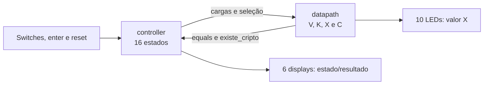

# Criptografia em VHDL

Projeto RTL para cifrar um valor de 10 bits e tentar recuperá-lo com uma chave. A implementação separa uma controladora de 16 estados de um datapath com quatro registradores e operações combinacionais.

> **Requisito:** compile em **VHDL-2008**. Essa versão está configurada em `NEW_Cripto.qsf`.

## Projeto

- Projeto Quartus: `NEW_Cripto.qpf`
- Entidade de topo: `Criptografia` (`Criptografia.vhd`)
- FPGA configurado: Intel MAX 10, `10M50DAF484C7G`
- Clock interno: divisor configurável pelo generic `DIVISOR` (padrão: 10.000.000 ciclos de `base_clock`)

## Entradas e saídas

| Sinal | Uso |
| --- | --- |
| `base_clock` | Clock de entrada. |
| `reset` | Botão ativo em `0`; retorna a controladora a `INIT` e limpa os registradores. |
| `enter` | Confirmação ativa em `0`; solte entre confirmações. |
| `sw(9 downto 0)` | Valor original, chave/palpite ou comandos, conforme o estado. |
| `sw(0)` | No menu: `0` inicia cifragem; `1` tenta decifrar. |
| `sw(1 downto 0)` | Nos estados de seleção, escolhe a operação. |
| `leds(9 downto 0)` | Mostra o valor atual de trabalho `X`. |
| `hex5`–`hex0` | Mostram o estado atual ou `ACERTO`/`ERRO`. Segmentos ativos em `0`. |

`modo` e `op` são sinais internos derivados dos switches, não portas separadas.

## Datapath e operações

Os quatro registradores de 10 bits guardam: `V` (valor original), `K` (chave/palpite), `X` (valor de trabalho) e `C` (cifrado salvo). Um multiplexador escolhe o próximo valor de `X`; a controladora gera as cargas e seleções.

| `op` | Cifragem | Tentativa de decifragem |
| --- | --- | --- |
| `00` | Salva `X` em `C`. | Compara `X` com `V` e mostra o resultado. |
| `01` | XOR de `X` com `K`. | Captura o palpite de chave e aplica XOR. |
| `10` | Rotaciona `X` três bits à esquerda. | Rotaciona três bits à direita. |
| `11` | Troca os bits de cada par adjacente. | Repete a permutação para desfazê-la. |

Na decifragem, aplique as operações inversas na ordem contrária. O comparador gera `equals` (`X = V`) e o registrador `C` informa se há um cifrado salvo (`existe_cripto`).

## Estados da controladora

Os estados também aparecem nos displays como números de `00` a `15`:

`INIT` → `MENU` → `INSERT_V` → `INSERT_K` → `SEL_OP_C` → `XOR_C` / `ROL_C` / `PERM_C` → `SAVE_C`.

Para decifrar: `MENU` → `ATTEMPT_D` → `SEL_OP_D` → `TRY_K` / `XOR_D` / `ROR_D` / `PERM_D` → `RESULT` → `MENU`.

As operações retornam ao estado de seleção para permitir uma sequência. Cada nova tentativa restaura `X` do cifrado salvo em `C`.

## Compilar e simular

1. Abra `NEW_Cripto.qpf` no Quartus Prime.
2. Confirme VHDL-2008 e o dispositivo no projeto.
3. Execute **Analysis & Elaboration** e depois **Start Compilation**.
4. Para simular, use o testbench `tb_Criptografia` configurado no NativeLink/ModelSim. Há também testbenches para a controladora e o datapath.

O arquivo `NEW_Cripto.qsf` contém as atribuições de pinos dos switches, botões, LEDs e displays. Os arquivos `.sof` e `.pof` em `output_files/` são resultados de compilação e podem precisar ser gerados novamente após mudanças.

## Fontes principais

- `Criptografia.vhd`: entidade de topo e interconexão dos blocos.
- `controller.vhd`: máquina de estados e sinais de controle.
- `datapath.vhd`: registradores, multiplexador, operações e flags.
- `registrador.vhd`, `comparador.vhd`, `xor_maker.vhd`, `roller.vhd`, `permuter.vhd`: componentes do datapath.
- `clock_div.vhd`: divisor de clock.
- `hex7seg.vhd`: decodificador dos displays.
- `tb_*.vhd`: testbenches.
