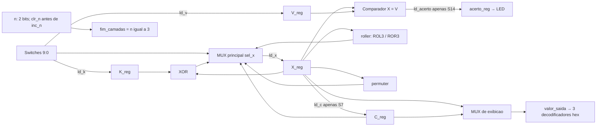
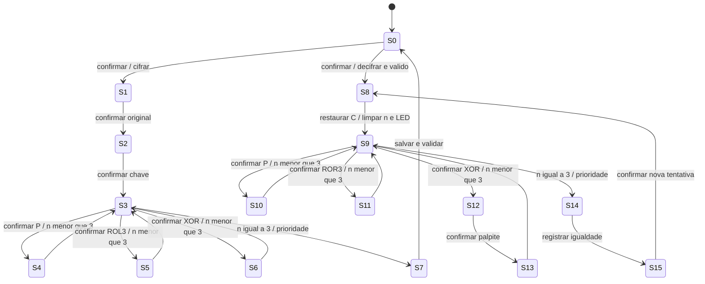

# Arquitetura da base do ZIP

Os diagramas abaixo foram feitos a partir da especificação atual. Não havia
figuras no ZIP. O reset síncrono leva qualquer estado a S0 e limpa o datapath.

## Datapath

| `sel_x` | Fonte do próximo `X_reg` |
|---|---|
| `000` | Switches |
| `001` | XOR |
| `010` | roller |
| `011` | permuter |
| `100` | C_reg |
| Outros | Mantém o valor de X_reg |

O MUX de exibição usa C_reg só em INIT com desafio válido. Nas tentativas,
V_reg e C_reg não recebem carga. `clr_valido` invalida o desafio sem precisar
apagar os bits de C_reg; reset apaga ambos. O contador prioriza `clr_n` quando
`clr_n` e `inc_n` valem 1 no mesmo ciclo.

## FSM de 16 estados

| Nº | Estado | Ação e saída |
|---|---|---|
| S0 | INIT | Com confirmação: cifrar invalida desafio/limpa acerto e vai a S1; decifrar só vai a S8 se válido |
| S1 | INSERIR_VALOR | Confirmação carrega V e X das switches; S2 |
| S2 | INSERIR_CHAVE_C | Confirmação carrega K e zera n; S3 |
| S3 | SELECIONAR_C | n=3: S7; senão confirmação válida escolhe S4, S5 ou S6 |
| S4 | PERMUTAR_C | X recebe P, n incrementa; S3 |
| S5 | ROL_C | X recebe ROL3, n incrementa; S3 |
| S6 | XOR_C | X recebe XOR, n incrementa; S3 |
| S7 | SALVAR_CIFRADO | C recebe X, ativa validade; S0 |
| S8 | PREPARA_TENTATIVA | X recebe C, zera n e apaga acerto; S9 |
| S9 | SELECIONAR_D | n=3: S14; senão confirmação válida escolhe S10, S11 ou S12 |
| S10 | PERMUTAR_D | X recebe P, n incrementa; S9 |
| S11 | ROR_D | X recebe ROR3, n incrementa; S9 |
| S12 | INSERIR_CHAVE_D | Confirmação carrega K; S13; não incrementa n |
| S13 | XOR_D | X recebe XOR, n incrementa; S9 |
| S14 | COMPARAR | Carrega acerto com X=V; S15 |
| S15 | RESULTADO | Mantém valor e acerto; confirmação leva a S8 |

Entradas sem confirmação e seleção `11` ficam aguardando. Os estados de execução,
preparação, salvamento e comparação duram um ciclo. Todas as saídas combinacionais
têm valores padrão, e todos os registradores usam o clock principal.

## Última camada e resultado registrado

Se antes da borda o estado é o da terceira operação, essa borda carrega X e faz
n=3, retornando ao seletor. A borda seguinte leva a S7 ou S14. Só na próxima
borda C ou acerto recebem carga. Assim os dois recebem o resultado já registrado
da terceira operação. Uma confirmação no seletor com n=3 não executa outra camada.

Na interface lógica, o pulso filtrado também é registrado: o núcleo o consome
na borda seguinte à sua geração. Nenhum processo usa `tick` como clock.
