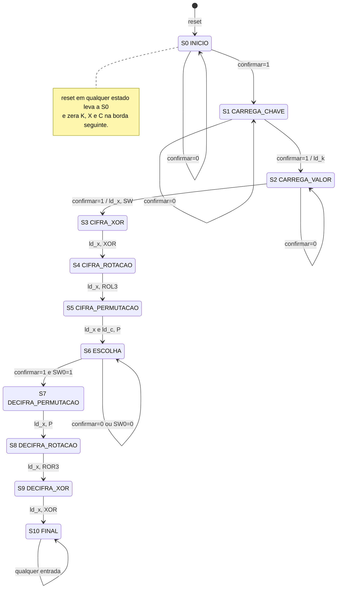
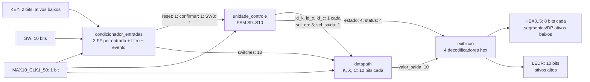
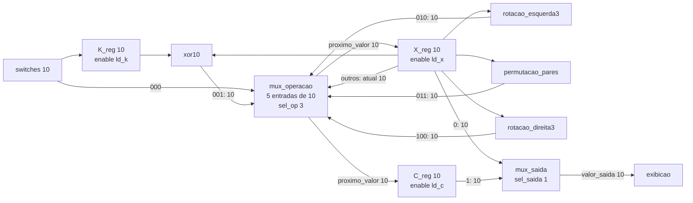

# Diagramas do sistema

Os diagramas Mermaid podem ser visualizados em um leitor Markdown com suporte
a Mermaid. Os arquivos VHDL são a implementação; o RTL Viewer do Quartus após
compilação permite conferir o circuito elaborado.

## FSM de alto nível

As ações escritas nas setas são executadas na borda que muda o estado. O diagrama
omite as onze setas de reset para facilitar a leitura; todas elas existem.

## Sistema RTL

Reset interno também chega aos três registradores do datapath. O mesmo clock
alimenta todos os blocos sequenciais; as operações e os MUXes são combinacionais.

## Datapath detalhado

`clk` e `reset` comuns aos três registradores foram omitidos das setas do datapath.
A realimentação de X passa obrigatoriamente por seu registrador. Em S5, `ld_x=ld_c=1`
captura a saída P no mesmo instante nos dois destinos; nas camadas inversas C retém.
